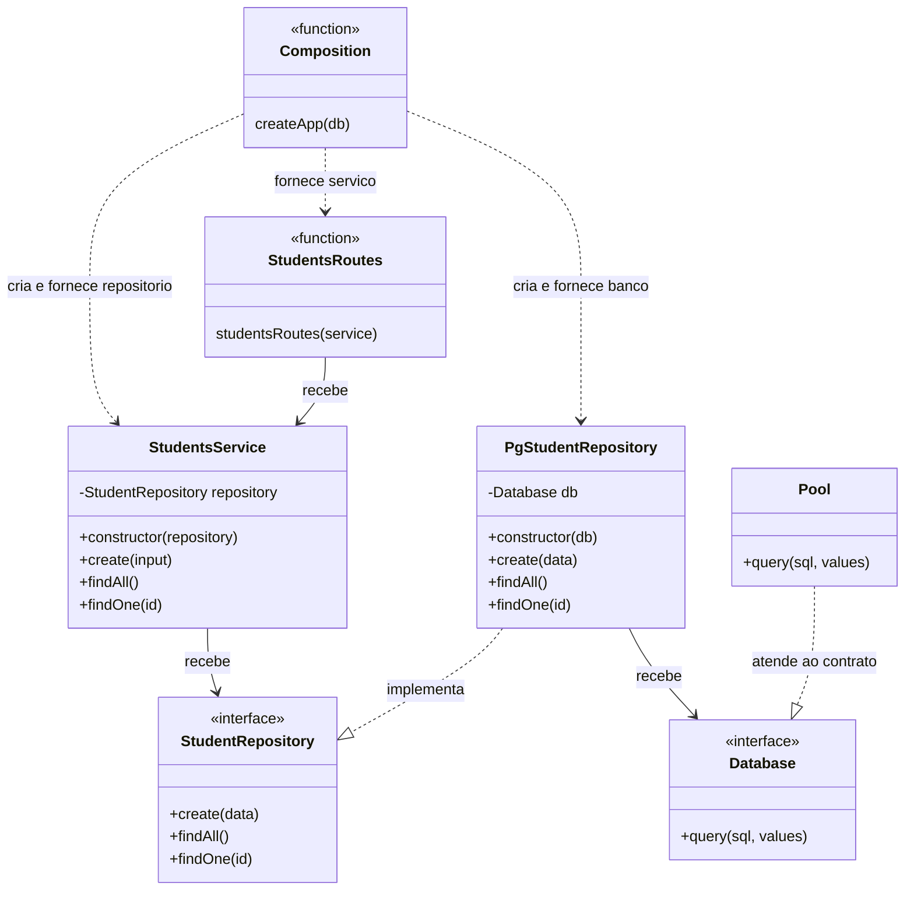
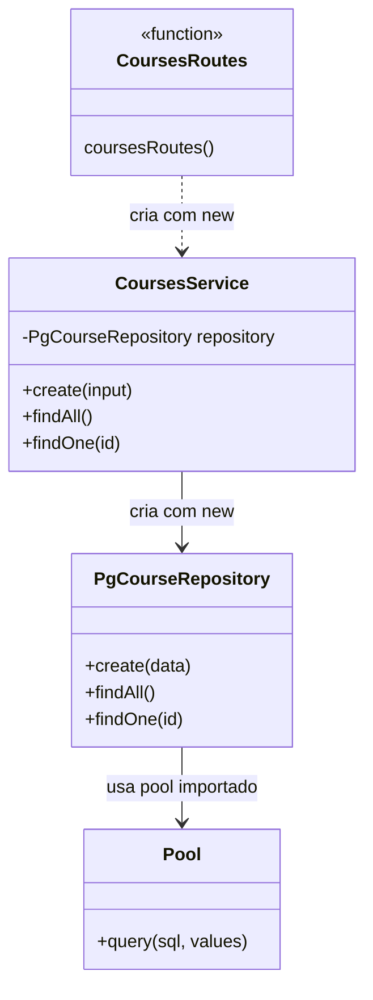
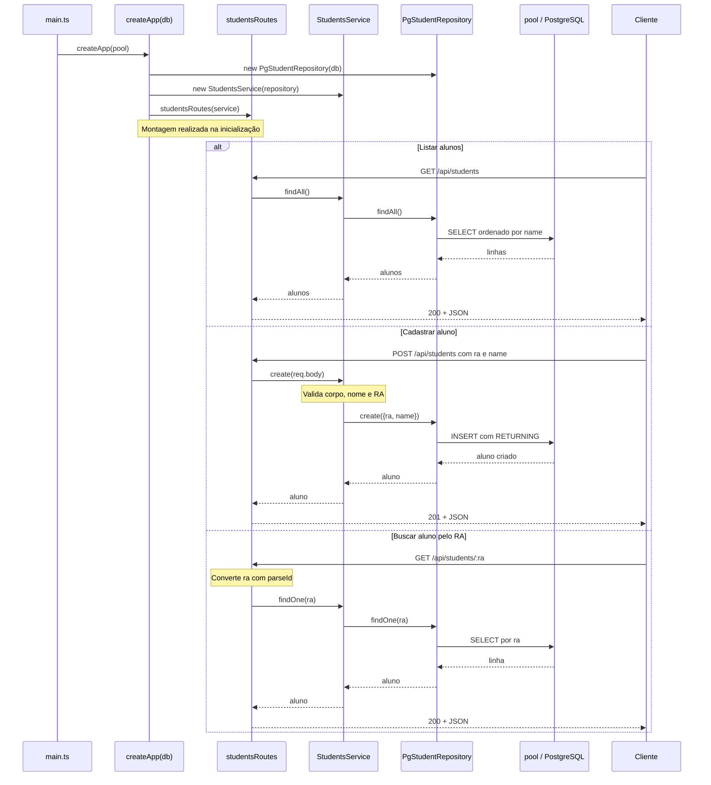
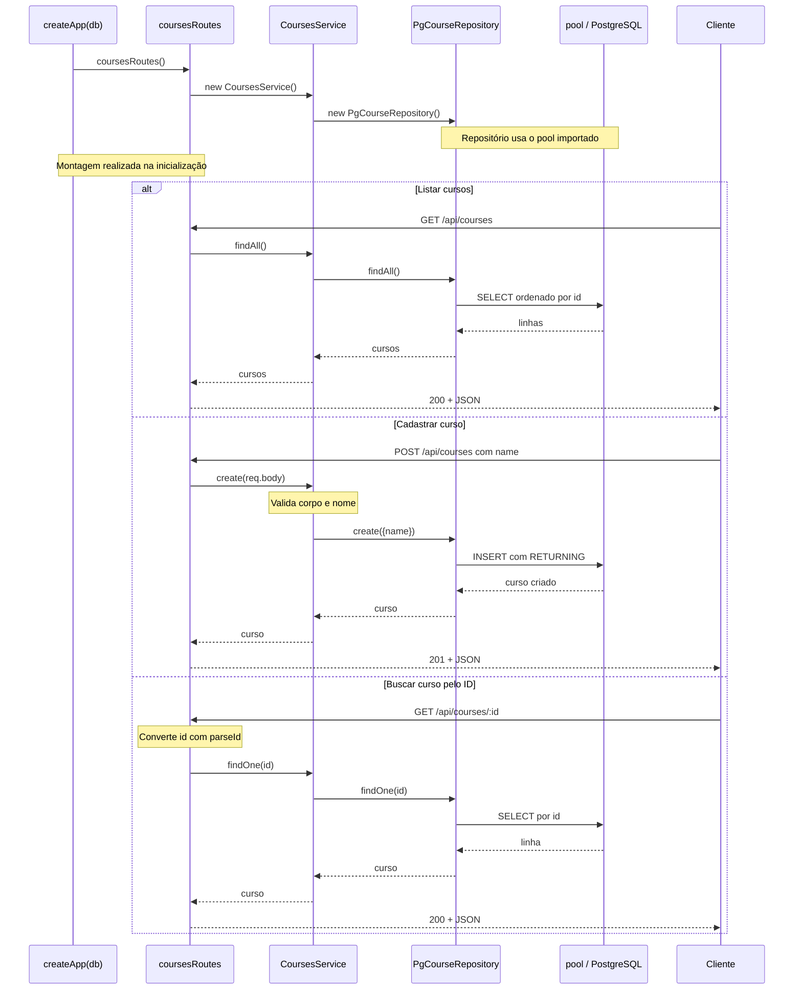

# Atividade: injeção de dependência

Este projeto permite cadastrar alunos, cursos e matrículas por uma API Express com TypeScript e PostgreSQL. O objetivo da atividade é **implementar injeção de dependência nos módulos de cursos (`courses`) e matrículas (`enrollments`)**, usando o módulo de alunos (`students`) como referência.

O projeto já funciona antes da atividade. Sua tarefa é mudar a maneira como os objetos recebem suas dependências, preservando o comportamento da aplicação.

## O que é injeção de dependência?

Uma **dependência** é um objeto de que outro objeto precisa para realizar seu trabalho. Neste projeto, o serviço precisa de um repositório para consultar e gravar dados; o repositório precisa de uma conexão com o banco.

**Injeção de dependência é fornecer essas dependências de fora, em vez de criá-las dentro de quem as utiliza.** O objeto continua usando a dependência, mas deixa a escolha e a criação dela para outra parte da aplicação.

Compare os serviços existentes:

```ts
// CoursesService: cria sua própria dependência.
export class CoursesService {
  private readonly repository = new PgCourseRepository();
}

// StudentsService: recebe sua dependência pelo construtor.
export class StudentsService {
  constructor(private readonly repository: StudentRepository) {}
}
```

No primeiro caso, o serviço escolhe a implementação `PgCourseRepository` e a instancia. Para trocar essa implementação, é necessário alterar o serviço. No segundo, quem cria o serviço fornece um objeto que atende ao contrato `StudentRepository`.

Uma **interface** descreve as operações que um objeto deve oferecer. `StudentRepository` exige `create`, `findAll` e `findOne`; `PgStudentRepository` implementa essas operações usando PostgreSQL. O serviço depende desse contrato e não precisa conhecer os detalhes do SQL.

As interfaces ajudam a definir contratos, mas sua presença, sozinha, não caracteriza injeção de dependência. A injeção acontece quando a dependência é **recebida de fora**. Neste projeto isso ocorre por parâmetros de construtores e de funções, sem necessidade de biblioteca ou contêiner de injeção.

### Quem monta os objetos?

Em [server/src/main.ts](server/src/main.ts), a aplicação recebe o `pool` com `createApp(pool)`. Para alunos, [server/src/app.ts](server/src/app.ts) monta a cadeia:

```ts
const studentRepository = new PgStudentRepository(db);
const studentsService = new StudentsService(studentRepository);
app.use("/api/students", studentsRoutes(studentsService));
```

O repositório recebe o banco, o serviço recebe o repositório e a função de rotas recebe o serviço. Esse local de montagem é chamado de **raiz de composição**. Usar `new` nesse local faz parte da solução: os objetos precisam ser criados, e a composição concentra essa responsabilidade.

A dependência é fornecida quando os objetos são montados. A cada requisição HTTP, as rotas usam os objetos já preparados; não precisam recriar essa cadeia.

## Estado inicial do projeto

| Camada | Alunos: exemplo com injeção | Cursos e matrículas: exercício |
| --- | --- | --- |
| Rotas | Recebem o serviço por parâmetro. | Criam o serviço com `new`. |
| Serviço | Recebe um repositório pelo contrato `StudentRepository`. | Cria o repositório concreto com `new`. |
| Repositório | Recebe o banco pelo contrato `Database`. | Importa e usa o `pool` diretamente. |
| Composição em `app.ts` | Conecta banco, repositório, serviço e rotas. | Chama as funções de rotas sem fornecer dependências. |

Essa diferença é intencional. Ao concluir a atividade, cursos e matrículas devem seguir o mesmo padrão de alunos.

## Diagramas de classes: estrutura atual

As funções de rotas e de composição aparecem como elementos com o estereótipo `function`; elas não são classes TypeScript.

### Alunos: dependências recebidas de fora



O `Pool` da biblioteca `pg` atende à interface `Database` por compatibilidade estrutural do TypeScript: ele oferece a operação exigida. Não é necessário modificar a classe da biblioteca para declarar `implements Database`.

### Cursos: dependências criadas internamente



O serviço de cursos conhece a classe concreta do repositório. O repositório usa diretamente o `pool` exportado por `connection.ts`. Matrículas apresenta a mesma organização inicial.

## Diagramas de sequência das rotas

Os exemplos abaixo mostram a montagem dos objetos e o caminho de sucesso de cada operação. As rotas convertem parâmetros de URL, os serviços validam os dados e aplicam regras, e os repositórios executam SQL parametrizado.

### Alunos: montagem com injeção e requisições



### Cursos: montagem interna e requisições



As chamadas HTTP percorrem camadas semelhantes nos dois módulos. A diferença está em **quem fornece as dependências** na inicialização. Após a refatoração de cursos, a montagem deve se parecer com a de alunos; os resultados HTTP devem continuar iguais.

Os diagramas omitem os caminhos de erro para facilitar a leitura. Entradas inválidas geram `400`, registros ausentes geram `404` e conflitos de unicidade geram `409`. Os erros seguem para o tratador de `app.ts`, que monta a resposta JSON.

## Sua tarefa

Refatore `courses` e `enrollments` seguindo o exemplo de `students`:

1. **Defina os contratos dos repositórios.** Crie `CourseRepository` e `EnrollmentRepository` com as operações existentes e seus tipos de entrada e retorno. As classes PostgreSQL devem implementar esses contratos.
2. **Injete o banco nos repositórios.** Receba `Database` pelo construtor e substitua o acesso ao `pool` importado pelo uso da dependência recebida. Reutilize o contrato de `database/connection.ts`.
3. **Injete os repositórios nos serviços.** Receba os respectivos contratos pelo construtor e remova a criação dos repositórios dentro dos serviços.
4. **Injete os serviços nas rotas.** Faça `coursesRoutes` e `enrollmentsRoutes` receberem seus serviços por parâmetro, como `studentsRoutes`.
5. **Monte as dependências em `app.ts`.** Use o banco recebido por `createApp(db)` para criar os repositórios, forneça-os aos serviços e forneça os serviços às rotas.

Preserve o módulo `students` como referência. Mantenha os endpoints, os corpos JSON, as validações, os códigos HTTP e as consultas SQL. A atividade não exige adicionar um framework de injeção.

### Critérios de conclusão

- Os serviços de cursos e matrículas recebem contratos de repositório e não instanciam repositórios concretos.
- Os repositórios recebem `Database` e não importam o `pool` diretamente.
- As funções de rotas recebem os serviços e não os instanciam.
- A montagem de ambos os módulos fica em `app.ts`, usando o mesmo `db` recebido pela aplicação.
- A verificação de tipos e a compilação passam, e as operações da API continuam funcionando.


## Executar a aplicação

Com Docker e Docker Compose instalados, copie `.env.example` para `.env` se ainda não existir e execute na raiz:

```powershell
Copy-Item .env.example .env
docker compose up -d --build
```

Execute a cópia apenas se ainda não tiver `.env`, para preservar sua configuração. Com os valores do modelo:

| Recurso | Endereço |
| --- | --- |
| Interface web | http://localhost:8080 |
| API de alunos | http://localhost:3002/api/students |
| API de cursos | http://localhost:3002/api/courses |
| API de matrículas | http://localhost:3002/api/enrollments |
| PostgreSQL | `localhost:5433` |

O banco aplica `database/init.sql` e `database/seed.sql` na primeira inicialização de um diretório de dados vazio. Os dados persistem no volume `atv3_database_data`.

Para encerrar os serviços:

```powershell
docker compose down
```

## Onde encontrar o código

| Caminho | Responsabilidade |
| --- | --- |
| [server/src/main.ts](server/src/main.ts) | Fornece o `pool` à aplicação e inicia o servidor HTTP. |
| [server/src/app.ts](server/src/app.ts) | Configura o Express, monta dependências e registra rotas e tratamento de erros. |
| [server/src/modules/students](server/src/modules/students) | Exemplo completo de injeção de dependência. |
| [server/src/modules/courses](server/src/modules/courses) | Módulo de cursos a refatorar. |
| [server/src/modules/enrollments](server/src/modules/enrollments) | Módulo de matrículas a refatorar. |
| [server/src/database/connection.ts](server/src/database/connection.ts) | Define o `pool` e o contrato `Database`. |
| `front/` | Interface web servida pelo Nginx. |
| `database/` | Estrutura SQL e dados iniciais. |
| [compose.yml](compose.yml) | Serviços Docker da aplicação. |
